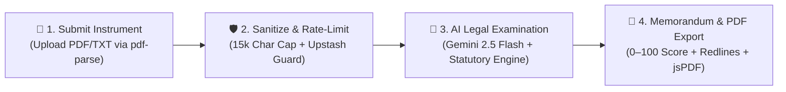
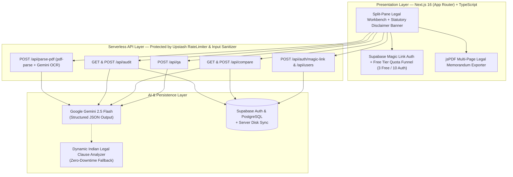

<div align="center">

# ⚖️ FinePrint Counsel

### **AI Contract Examination, Risk Scoring & Redline Advisory SaaS**

*An automated legal and financial shield that audits employment offer letters, residential leases, and freelance contracts under the Indian Contract Act, 1872—in under 6 seconds.*

[](https://nextjs.org/)
[](https://www.typescriptlang.org/)
[](https://ai.google.dev/)
[](https://supabase.com/)
[](https://upstash.com/)

[**Overview**](#-at-a-glance) · [**Core Workflow**](#-how-it-works-in-6-seconds) · [**Key Features**](#-feature-matrix) · [**Security & SaaS Guardrails**](#-security--saas-guardrails) · [**Architecture**](#️-system-architecture) · [**Quick Start**](#-quick-start)

</div>

---

## ⚡ At a Glance

94% of students, tenants, and freelancers sign employment offers, flat rental agreements, and client MSAs without reading the fine print—losing lakhs to hidden training bonds, asymmetric notice periods, and arbitrary security deposit forfeitures.

| Dimension | ❌ Without FinePrint Counsel | ✅ With FinePrint Counsel |
| :--- | :--- | :--- |
| **Review Speed** | 48–72 hours with a lawyer | **< 6 seconds** automated examination |
| **Cost per Contract** | ₹3,000 – ₹10,000 legal consultation fee | **Free Tier (3 Audits/Session) + Pro Tier** |
| **Language Clarity** | Dense legal jargon (`Liquidated Damages`, `Indemnity`) | **Plain English + Simple Hinglish** toggle |
| **Actionability** | Passive warnings with no next step | **1-Click Redline Email, WhatsApp & PDF Report Export** |
| **Multi-Offer Decision** | Manual spreadsheet guessing | **Side-by-Side Comparative Schedule & Winner Verdict** |

---

## 🔄 How It Works (In 6 Seconds)



---

## ✨ Feature Matrix

| Module | What It Does | Statutory / Technical Backing |
| :--- | :--- | :--- |
| **1. Document Examination Desk** | Ingests `.pdf` and `.txt` agreements via **`pdf-parse`** & **Gemini 2.5 Flash Multimodal**, computes a **0–100 Risk Index**, and extracts 4 key covenant metrics. | `pdf-parse` + Multimodal PDF OCR + JSON Schema |
| **2. Bilingual Clause Breakdown** | Classifies every clause into 🔴 **Critical Liability**, 🟡 **Negotiable Covenant**, or 🟢 **Balanced Provision** with verbatim quotes and **English / Hinglish** translations. | Indian Contract Act, 1872 (§27 & §74) |
| **3. Redline & Negotiation Writer** | Generates ready-to-send **Formal HR/Legal Emails** and **Polite WhatsApp Messages** (English & Hinglish) with specific clause replacement wording. | Non-adversarial commercial negotiation templates |
| **4. Multi-Page PDF Report Export** | Exports the complete Legal Memorandum, Risk Index stamp, examined clauses, and negotiation correspondence as a formatted **`.pdf` report** via `jsPDF`. | Client-side vector PDF generation (`jsPDF`) |
| **5. Comparative Legal Schedule** | Compares two competing job offers or rental leases side-by-side (`Instrument A vs Instrument B`) and declares a clear low-risk winner. | Multi-document head-to-head risk matrix |
| **6. Supabase Auth & Personal Docket** | Supports **Supabase Magic Link OTP Auth** (`/api/auth/magic-link`), personal saved audit history filtering, and a verified client registry. | `@supabase/supabase-js` Auth & PostgreSQL |

---

## 🛡️ Security & SaaS Guardrails

- **Supabase Magic Link Authentication:** Users can sign in via passwordless Magic Link email (`/api/auth/magic-link`) to unlock **10 audits/session** and filter their personal saved Case Docket.
- **Free Tier Quota & Pro Waitlist Funnel:** Guest users receive **3 free audits per session** with a live usage counter and an integrated **Pro Counsel (₹199/mo) Waitlist Conversion Funnel**.
- **API Rate Limiting (`@upstash/ratelimit`):** All AI routes (`/api/audit`, `/api/compare`, `/api/qa`, `/api/parse-pdf`) are protected by a sliding-window rate limiter (`10 requests / 60s per IP`) returning standard `X-RateLimit-*` headers and `429 Too Many Requests`.
- **Prompt-Injection Defense & Input Sanitization:** `src/lib/sanitize.ts` strips control characters, script tags, and prompt-override patterns while enforcing a strict **`15,000` maximum character limit** on `rawText`.
- **Statutory Legal Disclaimer:** Prominent top-bar, footer, and PDF report notices clarifying that analysis is informational and not a substitute for qualified legal advice under the **Advocates Act, 1961**.

---

## 🏗️ System Architecture



---

## 📂 Repository Structure

```text
fineprint-ai/
├── src/
│   ├── app/
│   │   ├── api/
│   │   │   ├── auth/magic-link/route.ts # Supabase Magic Link OTP authentication
│   │   │   ├── audit/route.ts           # Rate-limited & sanitized contract examination
│   │   │   ├── compare/route.ts         # Side-by-side 2-document comparison engine
│   │   │   ├── parse-pdf/route.ts       # pdf-parse + Gemini Multimodal PDF extraction
│   │   │   ├── qa/route.ts              # Context-grounded contract Q&A assistant
│   │   │   └── users/route.ts           # Verified client signup & waitlist API
│   │   ├── globals.css                  # Legal parchment theme & editorial typography
│   │   ├── layout.tsx                   # Root layout (Playfair Display + Inter + JetBrains Mono)
│   │   └── page.tsx                     # Split-pane Legal Workbench, Auth & Quota UI
│   ├── components/
│   │   ├── AuthAndWaitlistModal.tsx     # Supabase Magic Link Auth & Pro Waitlist funnel
│   │   ├── RiskGauge.tsx                # Executive Legal Memorandum & 0–100 Risk Stamp
│   │   ├── NegotiationPanel.tsx         # Email & WhatsApp redline script generator
│   │   ├── CompareOffersView.tsx        # Head-to-head instrument comparison schedule
│   │   └── CommunityUsersWall.tsx       # Live Supabase client registry & onboarding
│   ├── lib/
│   │   ├── aiEngine.ts                  # Gemini 2.5 Flash JSON engine + dynamic analyzer
│   │   ├── pdfExport.ts                 # Multi-page formatted PDF report exporter (jsPDF)
│   │   ├── rateLimiter.ts               # @upstash/ratelimit sliding window + IP bucket
│   │   ├── sanitize.ts                  # Prompt-injection defense & 15,000 char cap
│   │   ├── serverStore.ts               # Supabase PostgreSQL + disk synchronization
│   │   └── supabase.ts                  # Supabase client initialization
│   └── types/
│       └── fineprint.ts                 # Strict TypeScript interfaces
├── supabase/
│   └── schema.sql                       # PostgreSQL tables, indexes & RLS policies
└── .env.example                         # Environment configuration template
```

---

## 🚀 Quick Start

```bash
# 1. Clone & install dependencies
git clone https://github.com/kunshkaul365-cpu/fineprint-ai.git
cd fineprint-ai
npm install

# 2. Configure environment variables
cp .env.example .env.local
```

Add your keys to `.env.local`:

```env
GEMINI_API_KEY="your_gemini_api_key"
NEXT_PUBLIC_SUPABASE_URL="https://your-project.supabase.co"
SUPABASE_SERVICE_ROLE_KEY="your_supabase_service_role_key"
```

```bash
# 3. Start the development server at http://localhost:3000
npm run dev
```

---

<div align="center">
  <sub>Built for Capstone SaaS Launch • Powered by Next.js, TypeScript, Supabase & Google Gemini AI</sub>
</div>
