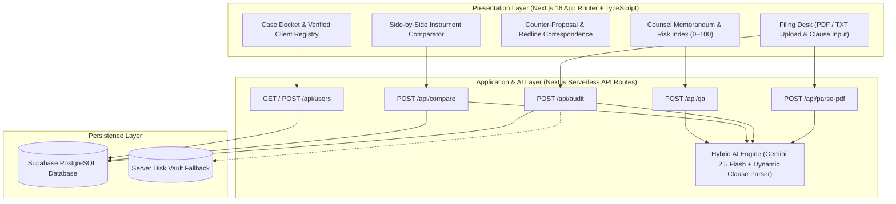

# ⚖️ FinePrint Counsel — AI Contract Examination & Redline Advisory SaaS

**FinePrint Counsel** is a full-stack LegalTech SaaS application engineered for Indian students, job seekers, tenants, and independent contractors. It examines employment offer letters, residential rental agreements, and commercial contracts in seconds—identifying hidden liabilities, computing a **0–100 Risk Index**, translating legal jargon into **Plain English and Simple Hinglish**, and drafting statutory counter-proposals grounded in the **Indian Contract Act, 1872**.

---

## 📌 1. Problem Statement & Market Gap

Across India, over **90% of early-career professionals, tenants, and freelancers** sign legally binding agreements without legal counsel due to two barriers:
1. **High Cost & Turnaround of Legal Review:** Consulting a contract lawyer costs ₹3,000–₹10,000 per agreement and takes 48–72 hours.
2. **Predatory Standard-Form Clauses:**
   - **Employment Offers:** Inflated CTC packages masking discretionary variable pay, ₹2,00,000+ service bonds, retention of original educational certificates, 90-day non-buyout notice periods paired with 7-day employer termination rights, and weekend side-project IP claims.
   - **Residential Leases:** 11-month full lock-in deposit forfeitures, mandatory 1.5-month painting deductions, and structural repair liabilities shifted onto tenants.
   - **Freelance MSAs:** Unlimited free revisions tied to subjective satisfaction gates, zero upfront milestones, and IP assignment prior to final payment.

**FinePrint Counsel** bridges this gap by delivering an instant, structured legal memorandum and ready-to-send negotiation correspondence in under 6 seconds.

---

## 🏗️ 2. System Architecture



---

## ✨ 3. Core Capabilities

### 3.1 Split-Pane Legal Workbench (`/`)
- **Multimodal Document Ingestion (`/api/parse-pdf`):** Supports direct `.pdf`, `.txt`, `.md`, and `.json` uploads using **Google Gemini 2.5 Flash** native multimodal PDF extraction alongside a zero-dependency binary PDF stream parser.
- **Executive Memorandum & Risk Index (`/api/audit`):** Evaluates the instrument on a `0–100` scale (`Safe & Balanced`, `Moderate Caution`, `High Risk — Negotiate Before Signing`) and extracts four core covenant metrics:
  - `§ Lock-In / Bond Period`
  - `§ Notice Requirement`
  - `§ Financial Liability Exposure`
  - `§ Mutuality of Exit`
- **Clause-by-Clause Examination:** Classifies every covenant into **Critical Liability (Red)**, **Negotiable Covenant (Yellow)**, or **Balanced Provision (Green)** with verbatim quotes, bilingual interpretation (**English & Hinglish**), financial impact, and exact redline amendments.

### 3.2 Counter-Proposal & Redline Correspondence
- Automatically drafts non-adversarial negotiation scripts tailored to the flagged clauses across three channels:
  1. **Formal Legal / HR Email** (with subject line and numbered clause amendments)
  2. **WhatsApp Counter-Proposal (Plain English)**
  3. **WhatsApp Counter-Proposal (Simple Hinglish)**
- Includes statutory leverage points referencing **Section 27** (restraint of trade / post-employment non-compete) and **Section 74** (reasonable compensation for breach vs penalty bonds) of the **Indian Contract Act, 1872**.

### 3.3 Side-by-Side Comparative Schedule (`/api/compare`)
- Evaluates two competing job offers or residential leases simultaneously (`Instrument A vs Instrument B`), computing individual Risk Indices, declaring a recommended winner, and rendering a covenant-by-covenant comparison matrix.

### 3.4 Omissions Detector & Direct Counsel Q&A (`/api/qa`)
- Flags protective clauses omitted from the draft (e.g., missing reciprocal notice rights, missing deposit refund timelines, uncapped indemnity).
- Enables context-grounded Q&A directly against the examined instrument.

### 3.5 Case Docket & Client Registry (`/api/users`)
- Persists all examined instruments, comparative schedules, and verified client registrations in **Supabase PostgreSQL**.

---

## 🔌 4. API & Input/Output (I/O) Specification

| Endpoint | Method | Request Payload | Response Schema |
| :--- | :---: | :--- | :--- |
| `/api/parse-pdf` | `POST` | `multipart/form-data` (`file`: `.pdf` / `.txt`) | `{ ok: boolean, fileName: string, extractedText: string }` |
| `/api/audit` | `GET` / `POST` | `{ documentTitle, category, rawText, userEmail?, userName? }` | `{ ok: boolean, audit: ContractAuditResult }` |
| `/api/compare` | `GET` / `POST` | `{ docATitle, docAText, docBTitle, docBText }` | `{ ok: boolean, comparison: ContractComparisonResult }` |
| `/api/qa` | `POST` | `{ question: string, audit: ContractAuditResult }` | `{ ok: boolean, answerEnglish: string, answerHinglish: string, actionTip: string }` |
| `/api/users` | `GET` / `POST` | `{ fullName, email, persona, organization, feedbackNote }` | `{ ok: boolean, user: UserProfileSignup, users: UserProfileSignup[] }` |

---

## 🗄️ 5. Database Schema (`supabase/schema.sql`)

The PostgreSQL schema consists of three primary relations protected by Row-Level Security (RLS):

1. **`public.user_profiles`**: Stores registered client profiles (`id`, `email`, `full_name`, `persona`, `organization`, `scans_completed`, `traps_detected`, `estimated_savings_inr`, `feedback_note`, `created_at`).
2. **`public.contract_audits`**: Stores examined contract memorandums (`id`, `document_title`, `category`, `raw_excerpt`, `risk_score`, `risk_verdict`, `executive_summary`, `hinglish_summary`, `estimated_financial_exposure`, `clauses` JSONB, `missing_protections` JSONB, `negotiation_scripts` JSONB, `key_metrics` JSONB, `created_at`).
3. **`public.contract_comparisons`**: Stores head-to-head comparative schedules (`id`, `comparison_title`, `doc_a_title`, `doc_b_title`, `winner`, `verdict_summary`, `hinglish_verdict`, `comparison_rows` JSONB, `created_at`).

---

## 🛠️ 6. Tech Stack

- **Framework:** Next.js 16 (App Router, Turbopack, Server & Client Components)
- **Language:** TypeScript 5 (Strict Mode)
- **Styling & Typography:** Tailwind CSS 4, `Playfair Display` (Legal Serif), `Inter` (UI Sans), `JetBrains Mono` (Citations & Clause Excerpts)
- **AI Engine:** Google Gemini 2.5 Flash (`@google/genai`) with structured JSON schema enforcement + deterministic legal clause fallback analyzer
- **Database:** Supabase PostgreSQL (`@supabase/supabase-js` & `pg`)
- **Icons:** Lucide React (`lucide-react`)

---

## 🚀 7. Local Development & Deployment

### Prerequisites
- Node.js `v20+` and `npm`
- A Google Gemini API Key ([aistudio.google.com/apikey](https://aistudio.google.com/apikey))
- A Supabase PostgreSQL Project ([supabase.com/dashboard](https://supabase.com/dashboard))

### Installation

```bash
# 1. Clone the repository
git clone https://github.com/kunshkaul365-cpu/fineprint-ai.git
cd fineprint-ai

# 2. Install dependencies
npm install

# 3. Configure environment variables
cp .env.example .env.local
```

Add your keys to `.env.local`:

```env
GEMINI_API_KEY="your_gemini_api_key"
NEXT_PUBLIC_SUPABASE_URL="https://your-project.supabase.co"
NEXT_PUBLIC_SUPABASE_ANON_KEY="your_supabase_anon_key"
SUPABASE_SERVICE_ROLE_KEY="your_supabase_service_role_key"
```

### Database Setup
Execute the SQL script located in `supabase/schema.sql` inside your Supabase SQL Editor to initialize the tables and indexes.

### Run Locally

```bash
# Start development server at http://localhost:3000
npm run dev

# Verify production build
npm run build
npm start
```

### Deploy on Vercel
1. Import `https://github.com/kunshkaul365-cpu/fineprint-ai` into [Vercel](https://vercel.com/new).
2. Add `GEMINI_API_KEY`, `NEXT_PUBLIC_SUPABASE_URL`, and `SUPABASE_SERVICE_ROLE_KEY` under **Project Settings → Environment Variables**.
3. Click **Deploy**.
