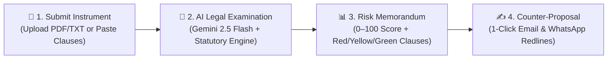
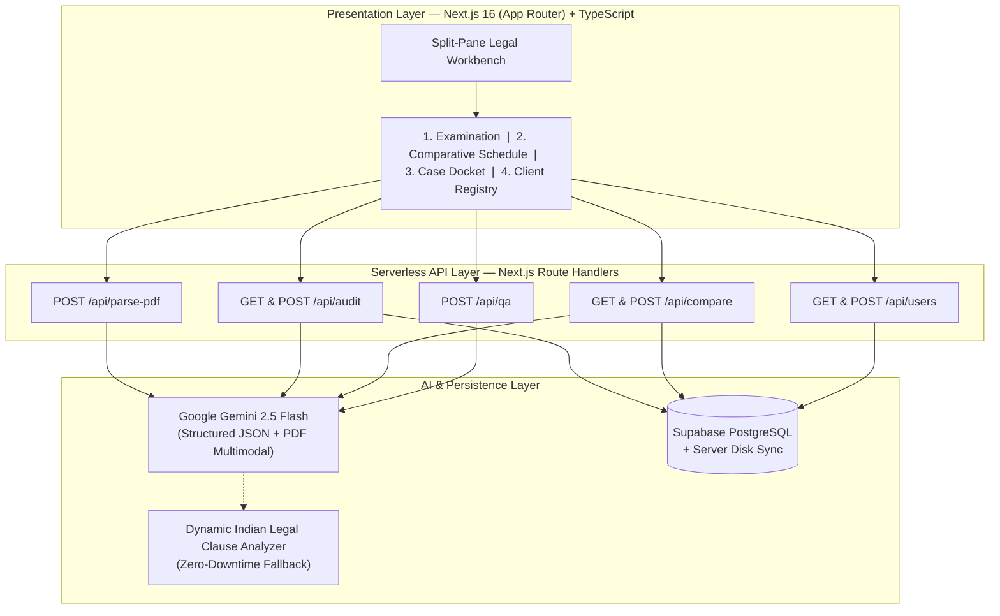

<div align="center">

# ⚖️ FinePrint Counsel

### **AI Contract Examination, Risk Scoring & Redline Advisory SaaS**

*An automated legal and financial shield that audits employment offer letters, residential leases, and freelance contracts under the Indian Contract Act, 1872—in under 6 seconds.*

[](https://nextjs.org/)
[](https://www.typescriptlang.org/)
[](https://ai.google.dev/)
[](https://supabase.com/)
[](https://tailwindcss.com/)

[**Overview**](#-at-a-glance) · [**Core Workflow**](#-how-it-works-in-6-seconds) · [**Key Features**](#-feature-matrix) · [**Architecture**](#️-system-architecture) · [**API & DB Schema**](#-api--database-reference) · [**Quick Start**](#-quick-start)

</div>

---

## ⚡ At a Glance

94% of students, tenants, and freelancers sign employment offers, flat rental agreements, and client MSAs without reading the fine print—losing lakhs to hidden training bonds, asymmetric notice periods, and arbitrary security deposit forfeitures.

| Dimension | ❌ Without FinePrint Counsel | ✅ With FinePrint Counsel |
| :--- | :--- | :--- |
| **Review Speed** | 48–72 hours with a lawyer | **< 6 seconds** automated examination |
| **Cost per Contract** | ₹3,000 – ₹10,000 legal consultation fee | **₹0** instant self-serve audit |
| **Language Clarity** | Dense legal jargon (`Liquidated Damages`, `Indemnity`) | **Plain English + Simple Hinglish** toggle |
| **Actionability** | Passive warnings with no next step | **1-Click Redline Email & WhatsApp Scripts** |
| **Multi-Offer Decision** | Manual spreadsheet guessing | **Side-by-Side Comparative Schedule & Winner Verdict** |

---

## 🔄 How It Works (In 6 Seconds)



---

## ✨ Feature Matrix

| Module | What It Does | Statutory / Technical Backing |
| :--- | :--- | :--- |
| **1. Document Examination Desk** |Ingests `.pdf` and `.txt` agreements, computes a **0–100 Risk Index**, and extracts 4 key covenant metrics (`Lock-In`, `Notice Period`, `Financial Liability`, `Exit Mutuality`). | Multimodal PDF OCR + Structured JSON Schema |
| **2. Bilingual Clause Breakdown** | Classifies every clause into 🔴 **Critical Liability**, 🟡 **Negotiable Covenant**, or 🟢 **Balanced Provision** with verbatim quotes and **English / Hinglish** translations. | Indian Contract Act, 1872 (§27 & §74) |
| **3. Redline & Negotiation Writer** | Generates ready-to-send **Formal HR/Legal Emails** and **Polite WhatsApp Messages** (English & Hinglish) with specific clause replacement wording. | Non-adversarial commercial negotiation templates |
| **4. Comparative Legal Schedule** | Compares two competing job offers or rental leases side-by-side (`Instrument A vs Instrument B`) and declares a clear low-risk winner. | Multi-document head-to-head risk matrix |
| **5. Omissions & Counsel Q&A** | Detects protective clauses missing from the draft and lets users ask context-grounded questions directly against their contract. | Context-grounded RAG over examined clauses |
| **6. Case Docket & Client Registry** | Persists all examined memorandums, comparisons, and verified client signups in **Supabase PostgreSQL**. | Dual-layer Supabase PG + Local Disk Vault |

---

## 🏗️ System Architecture



---

## 📂 Repository Structure

```text
fineprint-ai/
├── src/
│   ├── app/
│   │   ├── api/
│   │   │   ├── audit/route.ts       # Contract risk examination & DB persistence
│   │   │   ├── compare/route.ts     # Side-by-side 2-document comparison engine
│   │   │   ├── parse-pdf/route.ts   # Multimodal PDF & text clause extraction
│   │   │   ├── qa/route.ts          # Context-grounded contract Q&A assistant
│   │   │   └── users/route.ts       # Verified client signup & registry API
│   │   ├── globals.css              # Legal parchment theme & editorial typography
│   │   ├── layout.tsx               # Root layout (Playfair Display + Inter + JetBrains Mono)
│   │   └── page.tsx                 # Split-pane Legal Workbench & Docket UI
│   ├── components/
│   │   ├── RiskGauge.tsx            # Executive Legal Memorandum & 0–100 Risk Stamp
│   │   ├── NegotiationPanel.tsx     # Email & WhatsApp redline script generator
│   │   ├── CompareOffersView.tsx    # Head-to-head instrument comparison schedule
│   │   └── CommunityUsersWall.tsx   # Live Supabase client registry & onboarding
│   ├── lib/
│   │   ├── aiEngine.ts              # Gemini 2.5 Flash JSON engine + dynamic analyzer
│   │   ├── serverStore.ts           # Supabase PostgreSQL + disk synchronization
│   │   └── supabase.ts              # Supabase client initialization
│   └── types/
│       └── fineprint.ts             # Strict TypeScript interfaces
├── supabase/
│   └── schema.sql                   # PostgreSQL tables, indexes & RLS policies
└── .env.example                     # Environment configuration template
```

---

## 🔌 API & Database Reference

### REST API Endpoints

| Route | Method | Input | Output |
| :--- | :---: | :--- | :--- |
| `/api/parse-pdf` | `POST` | `FormData` (`file`: `.pdf` / `.txt`) | `{ ok, fileName, extractedText }` |
| `/api/audit` | `GET` / `POST` | `{ documentTitle, category, rawText }` | `{ ok, audit: ContractAuditResult }` |
| `/api/compare` | `GET` / `POST` | `{ docATitle, docAText, docBTitle, docBText }` | `{ ok, comparison: ContractComparisonResult }` |
| `/api/qa` | `POST` | `{ question, audit }` | `{ ok, answerEnglish, answerHinglish, actionTip }` |
| `/api/users` | `GET` / `POST` | `{ fullName, email, persona, organization, feedbackNote }` | `{ ok, user, users[] }` |

### PostgreSQL Tables (`supabase/schema.sql`)
- **`user_profiles`** — Verified user signups, persona (`Student`, `Tenant`, `Freelancer`, `Professional`), and feedback logs.
- **`contract_audits`** — Stored legal memorandums, `0–100` risk scores, JSONB clause breakdowns, and negotiation scripts.
- **`contract_comparisons`** — Stored side-by-side comparison matrices and AI winner verdicts.

---

## 🚀 Quick Start

```bash
# 1. Clone & install dependencies
git clone https://github.com/kunshkaul365-cpu/fineprint-ai.git
cd fineprint-ai
npm install

# 2. Configure environment variables
cp .env.example .env.local
```

Add your keys to `.env.local`:

```env
GEMINI_API_KEY="your_gemini_api_key"
NEXT_PUBLIC_SUPABASE_URL="https://your-project.supabase.co"
SUPABASE_SERVICE_ROLE_KEY="your_supabase_service_role_key"
```

```bash
# 3. Start the development server at http://localhost:3000
npm run dev
```

---

<div align="center">
  <sub>Built for Capstone SaaS Launch • Powered by Next.js, TypeScript, Supabase & Google Gemini AI</sub>
</div>
